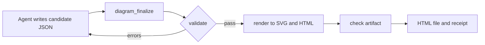

# Diagrammer guide

Diagrammer is an MCP server for AI agents. An agent describes a diagram as JSON. Diagrammer validates it, lays it out, and writes a single interactive HTML file you can open, explore and share.

- [How it works](#how-it-works)
- [Install](#install)
- [Quick start](#quick-start)
- [Reading a diagram](#reading-a-diagram)
- [Choosing a diagram type](#choosing-a-diagram-type)
- [Tools reference](#tools-reference)
- [Output files](#output-files)
- [Checks](#checks)
- [Diagnostics](#diagnostics)
- [Configuration](#configuration)
- [Troubleshooting](#troubleshooting)
- [Development](#development)

Field-by-field definitions of every diagram type are in the [schema reference](schema-reference.md).

## How it works



1. The agent picks a type. If it isn't sure, it asks `diagram_guide`.
2. It reads that type's tips, schema and example with `diagram_authoring_context`.
3. It writes a complete **candidate**: one JSON object that describes the diagram.
4. `diagram_finalize` runs three gates (validate, render, check) and writes the HTML file.
5. If a gate fails, the receipt lists each problem with a JSON path, such as `$.edges[3].to`. The agent fixes those paths and calls `diagram_finalize` again.

Every artifact is a single HTML file with no external requests. It embeds its source JSON, and a SHA-256 hash proves the drawing matches that source.

## Install

You need Node.js 18 or newer.

To register the server with Claude Code:

```bash
claude mcp add diagrammer -- npx -y diagrammer-mcp
```

To register it with another MCP client (Claude Desktop, Cursor, Windsurf, VS Code and others), add this to the client's MCP configuration:

```json
{
  "mcpServers": {
    "diagrammer": {
      "command": "npx",
      "args": ["-y", "diagrammer-mcp"]
    }
  }
}
```

Restart the client. Then check that the five `diagram_*` tools appear in its tool list.

To run from a clone instead, use these steps:

```bash
git clone https://github.com/VinodhDeva/diagrammer.git
```

```bash
cd diagrammer && npm install
```

```bash
claude mcp add diagrammer -- node /absolute/path/to/diagrammer/server.mjs
```

## Quick start

Ask your agent in plain language, for example:

- "Draw the architecture of this repository."
- "Show the login request as a sequence diagram."
- "Make a one-page explainer: should we move to a managed queue?"

The agent replies with a link to the HTML file. Open it in any modern browser.

You can also call the tools directly. This is a minimal `diagram_finalize` call:

```json
{
  "type": "workflow",
  "candidate": {
    "meta": { "title": "Deploy" },
    "steps": [
      { "id": "start", "label": "Merge to main", "kind": "start" },
      { "id": "test", "label": "Run tests", "kind": "tool" },
      { "id": "ok", "label": "Tests pass?", "kind": "decision" },
      { "id": "ship", "label": "Deploy", "kind": "end" },
      { "id": "fix", "label": "Fix and retry", "kind": "manual" }
    ],
    "transitions": [
      { "from": "start", "to": "test" },
      { "from": "test", "to": "ok" },
      { "from": "ok", "to": "ship", "label": "yes" },
      { "from": "ok", "to": "fix", "label": "no", "style": "error" },
      { "from": "fix", "to": "test", "style": "retry" }
    ]
  }
}
```

## Reading a diagram

Each page has a header with the title and a toolbar:

| Control | What it does |
|---|---|
| **Theme** | Switches between light and dark. The first time, it follows your system setting. |
| **Motion** | Turns animation on or off. Your choice is remembered. Motion starts off when your system's reduced-motion setting is on. |
| **SVG** / **PNG** | Downloads the diagram. PNG is rendered at 2× and always captures a still frame. These buttons don't appear on explainer pages. |

### Inspect an item

Hover over any box to open the details panel in the bottom-right corner. You can also press <kbd>Tab</kbd> to reach it with the keyboard. The panel shows:

- the item's name, kind, group and description;
- the data the item carries: ERD columns and keys, class members, waterfall timings, or timeline time and lane;
- **Upstream · incoming** connections, marked in **amber**;
- **Downstream · outgoing** connections, marked in **green**.

While an item is in focus, the diagram dims everything else. The item stays bright, and its direct connections are colored: amber for upstream, green for downstream.

**Click** an item, or press <kbd>Enter</kbd>, to **pin** the panel. A pinned panel stays put while you move around. Each upstream and downstream entry is a button: click it to jump to that item, which pins it next. This lets you follow a request through the system one hop at a time.

What upstream and downstream mean differs by diagram type:

| Diagram | Upstream (incoming) | Downstream (outgoing) |
|---|---|---|
| architecture, workflow, dataflow, lifecycle | links that point to the item | links that leave the item |
| sequence: participant | messages it receives | messages it sends |
| sequence: message | the sender | the receiver |
| ERD, class | relationships whose `to` is this item | relationships whose `from` is this item |
| tree | the parent | the children |
| waterfall | the enclosing span | the nested spans |
| timeline | none: an event shows its time and lane only | none |

### Zoom and pan

A zoom bar sits above every diagram.

- Diagrams open at the size that fits the width. If fitting would shrink them below 75%, they open at 75% instead and you scroll to see the rest. That keeps labels readable.
- `−` and `+` zoom out and in. **Fit** shows the whole diagram, and **100%** shows it at natural size.
- To zoom around the pointer, hold <kbd>Ctrl</kbd> (or <kbd>⌘</kbd> on a Mac) and scroll.
- To pan, drag the empty background. Scrollbars work too.

### Keyboard

| Key | Action |
|---|---|
| <kbd>Tab</kbd> / <kbd>Shift</kbd>+<kbd>Tab</kbd> | Move between toolbar buttons, zoom controls and diagram items. |
| <kbd>Enter</kbd> or <kbd>Space</kbd> on an item | Pin its details and move focus into the panel. |
| <kbd>Tab</kbd> / <kbd>Enter</kbd> in the panel | Pick a listed neighbor to jump to it. Focus moves to that item, so press <kbd>Enter</kbd> again to continue the trace. |
| <kbd>Esc</kbd> | Close the panel, clear the highlight, and return focus to the item. |

### Accessibility

- Every item can be reached with the keyboard. It has a clear focus ring and a spoken label that gives its kind, name and connection count, for example "service AppShell, 1 upstream, 5 downstream".
- The details panel is announced to screen readers as it changes.
- Upstream and downstream are shown by color, by side bars and by labeled sections, so color is never the only cue.
- Small colored captions are blended toward the text color to keep them readable in both themes.
- Motion respects your system's reduced-motion setting.

## Choosing a diagram type

| Type | Use it when the question is… |
|---|---|
| `architecture` | What is the system made of, and how do the parts connect? |
| `workflow` | What are the steps, decisions and outcomes of a process? |
| `sequence` | Who calls whom, in what order, and what comes back? |
| `dataflow` | Where does data come from, how is it transformed, and who consumes it? |
| `lifecycle` | What states does something move through, and which events move it? |
| `erd` | What tables exist, with which columns and keys, and how do they relate? |
| `class` | What types exist, with which members, and how do they inherit or compose? |
| `tree` | How does something break down into parts that each have one parent? |
| `timeline` | When did things happen, and in which source? |
| `waterfall` | Where did the time go in one request or run? |
| `explainer` | Can you answer this on one page: the conclusion first, then the support? |

If you're unsure, `diagram_guide` recommends a type for a scenario. Converting from Mermaid is direct: `flowchart` becomes `workflow` or `architecture`, `sequenceDiagram` becomes `sequence`, `stateDiagram` becomes `lifecycle`, `erDiagram` becomes `erd`, and `classDiagram` becomes `class`.

## Tools reference

All tools return text content. A failure sets `isError: true`.

### `diagram_guide`

Recommends a diagram type.

| Input | Type | |
|---|---|---|
| `scenario` | string | A question or description, for example "latency breakdown of a slow request". |

It returns `recommendation`, `confidence` (`high`, `medium` or `low`), the matched keywords, a one-line reason, and the alternatives.

### `diagram_authoring_context`

Returns the authoring tips, the full JSON schema and a worked example for one type. Agents should read it before writing a candidate.

| Input | Type | |
|---|---|---|
| `type` | string, required | One of the 11 types. |

### `diagram_finalize`

The main tool. It validates, renders and checks the candidate, then writes the HTML file and a receipt.

| Input | Type | |
|---|---|---|
| `type` | string, required | Diagram type. |
| `candidate` | object | The candidate JSON. Give this or `candidate_path`. |
| `candidate_path` | string | Path to a candidate JSON file. |
| `work_dir` | string | Reuse an existing artifact folder, for example when repairing. |
| `output` | string | Path of the HTML file to write. Defaults to `<work_dir>/<slug>.html`. |

The response starts with `PASS: <path>`, or with `FAIL at <gate>`, and then the receipt.

### `diagram_validate`

Validates a candidate without writing any files. It takes `type` and `candidate` (or `candidate_path`), and returns `{ ok, diagnostics }`.

### `diagram_check`

Re-checks an existing HTML artifact. It takes `html` (a path) and returns `{ ok, type, sha256, diagnostics }`. Use it to confirm that a file hasn't been edited since it was rendered.

## Output files

Each new artifact gets its own folder: `.diagrams/<type>-<slug>-<YYYYMMDD-HHMMSS>/`. The folder is created in the server's working directory, or in `DIAGRAM_WORKDIR` if you set it. It holds three files:

| File | Contents |
|---|---|
| `candidate.json` | The exact input. |
| `<slug>.html` | The artifact. |
| `<slug>.receipt.json` | Gate results, artifact hash and diagnostics. |

The HTML file and the receipt are written atomically, so a failed write never leaves half a file behind.

This is an example receipt:

```json
{
  "ok": true,
  "generator": "diagrammer 0.6.0",
  "type": "sequence",
  "work_dir": "/repo/.diagrams/sequence-login-20261103-101500",
  "candidate": "/repo/.diagrams/sequence-login-20261103-101500/candidate.json",
  "gates": { "validate": "pass", "render": "pass", "check": "pass" },
  "artifact": { "path": "/repo/.diagrams/sequence-login-20261103-101500/login.html", "sha256": "…", "bytes": 61234 },
  "diagnostics": []
}
```

## Checks

`diagram_finalize` stops at the first gate that fails.

1. **validate.** First the candidate must match the type's schema: required fields, allowed values, lengths, patterns, and no unknown fields. Then come semantic rules, which are errors or warnings (see [Diagnostics](#diagnostics)). Warnings never block delivery, but they usually point at a broken flow.
2. **render.** Layout and drawing. Graph types use [dagre](https://github.com/dagrejs/dagre). Sequence, timeline and waterfall diagrams have their own layouts.
3. **check.** This gate runs on the finished file and checks four things:
   - The embedded source must match its SHA-256 hash.
   - The page body must match a fresh render of that source exactly.
   - There must be no drawing outside the body.
   - The file must load no external resources.

Renders are deterministic. The same candidate always produces identical bytes on any machine and in any time zone, and that is what makes the tamper check possible.

## Diagnostics

Every diagnostic has a `severity`, a `code`, a JSON `path` and a `message`.

### Errors (block delivery)

| Code | Types | Meaning and fix |
|---|---|---|
| `schema` | all | A field is missing, unknown, the wrong type, or outside its allowed values or length. Check the [schema reference](schema-reference.md). |
| `type` | all | `type` is not one of the 11 supported types. |
| `duplicate-id` | all with ids | Two items share an `id`. Make each one unique. |
| `unknown-ref` | all | A `from`, `to`, `group`, `parent`, `lane` or `references` names something that doesn't exist. |
| `group-cycle` | graph types | A group is nested inside itself through `parent`. |
| `fragment-overlap` | sequence | Two fragments partly overlap. Fragments must nest. |
| `fragment-range` | sequence | A fragment's `end` is before its `start`, or past the last message. |
| `fk-references` | erd | A column with key `fk` has no `references`. |
| `bad-reference` | erd | `references` is not in `table.column` form. |
| `duplicate-column` | erd | A table has two columns with the same name. |
| `inheritance-cycle` | class | A class inherits from itself, directly or through other classes. |
| `tree-root` | tree | The tree must have exactly one node without a `parent`. |
| `tree-cycle` | tree | A node is its own ancestor. |
| `bad-time` | timeline | A date matches the format but doesn't exist, such as month 13. |
| `lane-required` | timeline | Lanes are defined, but an event has no `lane`. |
| `period-range` | timeline | A period ends before it starts. |
| `span-cycle` | waterfall | A span is its own ancestor. |
| `panel-field` | explainer | A panel is missing a field its kind needs, for example a table without `rows`. |
| `row-length` | explainer | A table row has a different number of cells than there are columns. |
| `render` | all | Layout failed unexpectedly. Report it with the candidate. |
| `provenance`, `body-mismatch`, `svg`, `source`, `external`, `size` | check gate | The HTML file was edited after rendering, is corrupt, or is over 8 MB. Render it again. |

An embedded diagram inside an explainer reports its own errors with paths inside the panel, for example `$.panels[4].diagram.flows[0].to`.

### Warnings (delivered, but worth fixing)

| Code | Types | Meaning |
|---|---|---|
| `isolated` | graph types | An item has no links. |
| `empty-group` | graph types | A group contains nothing, so it isn't drawn. |
| `duplicate-link` | graph types | The same link appears twice. |
| `too-dense` | most | More than about 60 to 80 items. Consider splitting the diagram. |
| `no-start`, `no-end` | workflow | There is no step of kind `start` or `end`. |
| `decision-branches` | workflow | A decision has fewer than 2 outgoing transitions. |
| `end-outgoing` | workflow | An end step has outgoing transitions. |
| `unreachable` | workflow, lifecycle | An item can't be reached from the start or initial item. |
| `initial-count` | lifecycle | There isn't exactly one initial state. |
| `initial-incoming`, `final-outgoing` | lifecycle | The initial state has incoming transitions, or a final state has outgoing ones. |
| `dead-end` | lifecycle | A state that isn't final has no way out. |
| `source-incoming`, `sink-outgoing` | dataflow | A source has inputs, or a sink has outputs. |
| `no-primary-key` | erd | A table has no `pk` column. |
| `missing-fk` | erd | A column has `references` but no `fk` key. |
| `realization-target` | class | Something other than an interface is realized. |
| `self-return` | sequence | A return message is sent to its own sender. |
| `empty-lane` | timeline | A lane has no events. |
| `outside-parent` | waterfall | A span runs outside its parent's time window. |
| `unused-field` | explainer | A panel field is ignored for that panel kind. |
| `single-option` | explainer | A comparison has only one option. |
| `too-many-panels` | explainer | There are more than 8 panels. |

## Configuration

| Environment variable | Default | Meaning |
|---|---|---|
| `DIAGRAM_WORKDIR` | the server's working directory | Base folder for relative paths and the `.diagrams/` output. |

To set it in an MCP client configuration:

```json
{ "command": "npx", "args": ["-y", "diagrammer-mcp"], "env": { "DIAGRAM_WORKDIR": "/path/to/project" } }
```

## Troubleshooting

| Symptom | What to do |
|---|---|
| The tools don't appear in the client. | Restart the client after registering. Check that `node --version` is 18 or newer. |
| An old version runs after an update. | `npx` caches packages. Use `npx -y diagrammer-mcp@latest`, or clear the npx cache. |
| The diagram is very wide and tiny. | Use **Fit** for an overview and zoom in to read. For architecture, set `"meta": { "direction": "TB" }`, or split the diagram by boundary. |
| A timeline is rejected with `schema` on `at`. | Date-times need a zone: `2026-03-04T14:02:00Z` or `…+05:30`. A plain date such as `2026-03-04` also works. |
| `diagram_check` reports `provenance` or `body-mismatch`. | The HTML file was changed after rendering. Render it again from `candidate.json`. |
| There's no animation. | Check the **Motion** button and your system's reduced-motion setting. |
| A PNG export looks empty. | Update to 0.5.0 or later. PNG always exports a still frame. |

## Development

```bash
npm install
```

```bash
npm test
```

`npm test` checks that the schema reference is up to date. It then starts the server over stdio and covers four areas:
- every example, end to end, with zero warnings;
- the type-specific validation rules;
- escaping of hostile labels;
- tamper detection, and identical renders across time zones.

| Path | Contents |
|---|---|
| `server.mjs` | MCP protocol (stdio JSON-RPC) and the five tools. |
| `lib/validate.mjs` | Schema-subset validator and semantic rules. |
| `lib/graph.mjs` | dagre-based engine for architecture, workflow, dataflow, lifecycle and tree. |
| `lib/tables.mjs` | ERD and class boxes, with crow's-foot and UML markers. |
| `lib/sequence.mjs`, `lib/time.mjs` | Sequence, timeline and waterfall layouts. |
| `lib/explainer.mjs` | Explainer page body. |
| `lib/html.mjs` | Page shell and the artifact check. |
| `lib/viewer.js`, `lib/viewer.css` | Browser runtime: details panel, highlighting, zoom and pan, theme, motion, export. |
| `lib/svg.mjs` | Shared SVG helpers, theme and motion styles. |
| `schemas/` | One JSON schema per type. This is the source of truth for fields. |
| `examples/` | One worked example per type. |
| `scripts/schema-docs.mjs` | Generates `docs/schema-reference.md`. |

**Adding a field.** Change the schema, run `npm run docs`, update the renderer if needed, and update the example if it should show the field.

**Releasing.**
1. Bump `version` in `package.json` and `VERSION` in `lib/html.mjs`.
2. Run `npm test`.
3. Commit, then run `npm publish`.
